# 中南点点失物招领功能说明

新增功能与优化说明。供学生、老师和学工老师介绍使用，同时供技术开发对照实现。

本文描述的是当前可点击原型，数据版本为 6。移动端、PC 前台、管理端共用同一份演示数据。文中的页面、状态名称、权限和字段，都以原型里现在能走通的效果为准。

## 目录

1. 背景与目标
2. 谁在用，演示时从哪里进
3. 新增功能说明
4. 按反馈完成的优化
5. 给开发对照的规则
6. 演示数据与原型边界

## 一、背景与目标

校园里捡到校园卡、证件和生活用品，过去多靠班级群、食堂告示和值班本。寻物的人不知道东西在哪个服务点，捡到的人也不知道交给谁核对。资助团队每天要登记一批校园卡，再用表格做当天汇总，同学很难第一眼找到入口。

这一轮在中南点点里增加独立的「失物招领」，并把两份使用反馈里已经改过的体验一并放进原型。帖子、评论、投票、举报仍走原来的心声社区。失物招领单独记账，三端看到的是同一批物品、认领和线索。

做到下面这些，就算这一版介绍和开发对齐了：

- 学生从首页能看见失物招领，再进入列表，可以发布拾物或寻物、提交认领、给别人的寻物提供线索。
- 资助团队按服务点登记物品、核对认领、安排交接，并发布含团队登记和学生登记的每日汇总。
- 寻物线索的正文只有寻物发布者能看。
- 待核对、待补充的认领可以修改和撤回；已经通过或已经完成的不能撤回。
- 校区使用岳麓山、潇湘、麓南、天心、开福、杏林六个名称。

本期是演示原型，成功标准是介绍时路径走得通、规则和界面一致。不设上线后的访问量或转化指标。正式系统上线后，可以再统计发布量、认领完成量和超过 30 天未领的数量。

本期做的范围：失物招领的发布、列表、详情、认领、线索、团队台账、批量登记、每日汇总、服务点与成员，以及下文列出的界面优化。

本期不做的范围：不替换原有发帖、评论、投票和举报流程；不连接真实统一身份认证和业务库；用户管理里的「官方认证」和成员表里的「配置」只在当前页示意，不改真实权限。

## 二、谁在用，演示时从哪里进

### 2.1 四种使用身份

| 身份 | 演示账号 | 主要要做的事 | 做成之后 |
| --- | --- | --- | --- |
| 学生 | 林知夏（橘子洲的风） | 看自己的寻物和认领进度，接收线索 | 首页进入失物招领，能看到待补充的认领，以及别人提供的线索 |
| 学生 | 陈语桐（小麓同学） | 给别人的寻物提供线索 | 能打开林知夏的「白色耳机盒」，可以提交线索，看不到已有线索正文 |
| 资助团队登记兼核对 | 周以宁（资助团队·周同学） | 登记物品，核对称认领，安排交接 | 管理端只有失物招领；台账限于所负责的服务点 |
| 资助团队仅登记 | 许嘉禾（资助团队·许同学） | 登记潇湘校区服务点的物品 | 不能核对称认领；台账只显示潇湘校区服务点保管的物品 |
| 超级管理员 | 学工系统管理员 | 看全部后台，并对照学生看到的前台 | 原有管理菜单都在，下面增加「失物招领」 |

团队里还有一个角色叫「管理员」，负责配置服务点和异常处理。成员表里用陈语桐这一行演示这个角色，方便讲解。陈语桐的登录账号仍然是普通学生，点「配置」不会让这个账号真正获得管理权限。

周以宁同时具有登记和核对，负责岳麓山校区服务点、天心校区事务服务点、天心校区服务点、开福校区服务点、毓秀楼服务点、雷锋岗服务点。许嘉禾只有登记，负责潇湘校区服务点。

### 2.2 演示路径

打开仓库里的 `index.html`，这是演示入口。点某个端口，会换成该身份并打开对应首页。到了首页之后，再自己点进失物招领或后台。入口页不会直接打开某一条招领。

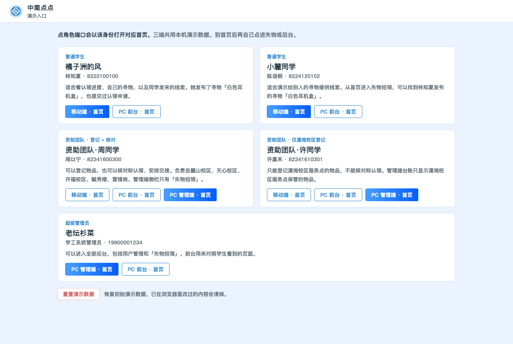

图1 演示入口。先选身份和端口，进入的是该端首页。底部可以重置演示数据。

推荐的介绍顺序：

1. 用林知夏打开「移动端 · 首页」或「PC 前台 · 首页」。首页搜索或轮播下方有蓝色「失物招领」，点进去才是失物列表。
2. 用陈语桐从首页进入失物招领，打开寻物「白色耳机盒」，演示「可以提供线索，正文只有失主可见」。
3. 用周以宁在 PC 顶栏进入「中南点点管理」。团队成员打开的是失物台账，左侧只有「失物招领」一组菜单。
4. 用超级管理员打开「PC 管理端 · 首页」，先看到原来的数据概览，侧栏下方多出「失物招领」。

有一处和按钮文案需要当场说明：入口页上资助团队的「PC 管理端 · 首页」打开的是数据概览。团队成员没有数据概览权限，原型会回到 PC 前台首页。请改用 PC 顶栏的「中南点点管理」，或在前台失物列表右侧点「招领工作台」。移动端则从「我的」进入「招领工作台」。

三端数据在浏览器本地共用。一边登记，另一边刷新就能看到。若校区仍显示本部、铁道、湘雅等旧名称，在入口页、移动端原型面板或 PC 右上角用户菜单里点「重置演示数据」。当前数据版本是 6，版本对不上时，打开页面也会自动换回这套初始数据。

## 三、新增功能说明

### 3.1 独立板块和入口

失物招领是独立板块，有自己的物品、认领、线索、服务点和每日汇总。移动端、PC 前台、管理端读的是同一份数据。它挂在原来的中南点点里面，发布时也可以从原来的「发布心声」进入，但物品本身不进帖子列表。

入口都在各端首页上，点一次进入的是失物列表，中间还有首页这一步。

移动端首页：搜索框下面、分类上面，是一条蓝色横幅，标题「失物招领」，副标题「捡到物品 · 寻物求助」。

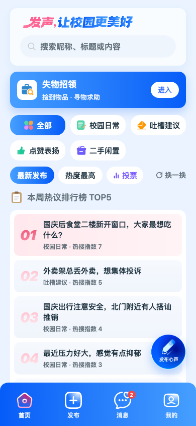

图2 移动端首页。蓝色横幅在搜索和分类之间。本周热议已改成从上到下的单列，每条都有分类和热搜指数。右下角蓝圆按钮是「发布心声」。

点横幅进入失物列表。列表上方是今日汇总和资助团队招领站，下面才是「捡到物品 / 寻物求助」。右下角蓝圆按钮换成「发布招领」。

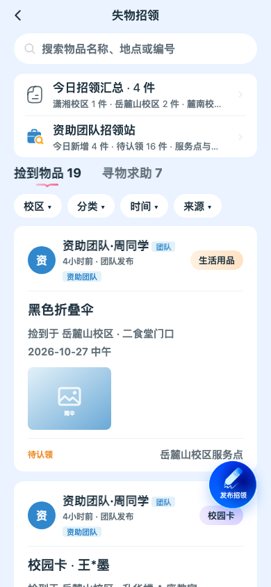

图3 移动端失物列表。团队登记的物品同时有「团队」和「资助团队」标记。

PC 首页：轮播图下面是同样的蓝色横幅，并带上待认领和寻找中的数量。右侧「发布心声」仍是原来的按钮。本周热议在右侧，本来就是一行一条。

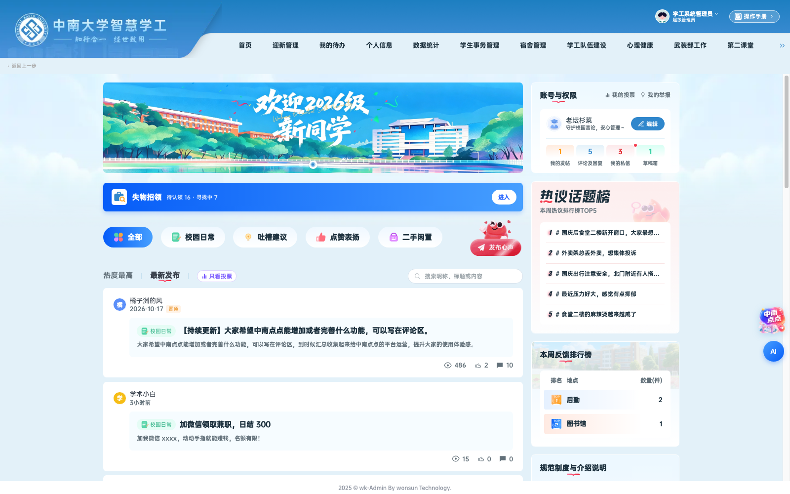

图4 PC 首页。失物招领在轮播下方，发布仍走原来的「发布心声」。

PC 失物列表的顶部集中放三块：招领站数字（今日登记、待认领、寻找中）、当天汇总、筛选。右侧上面是「我的失物招领」，下面是「服务点与值班」。来源筛选项是「全部来源 / 团队发布 / 同学发布」。

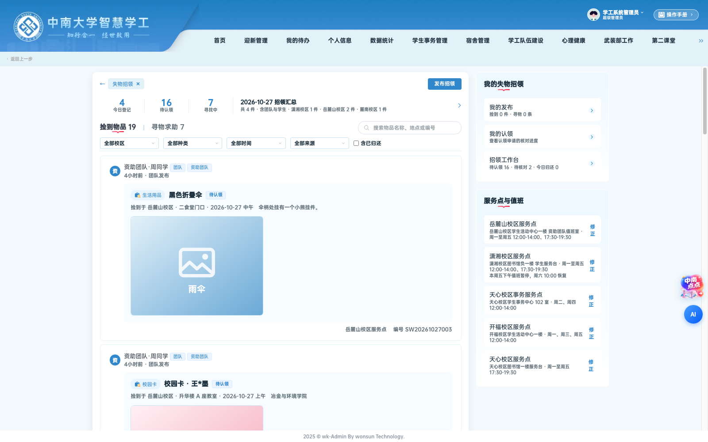

图5 PC 失物列表。顶部是数字、当日汇总和筛选；右侧上为「我的失物招领」，下为「服务点与值班」。图中登录的是超级管理员，所以服务点旁有「修正」，「我的失物招领」里还有「招领工作台」。学生登录时没有这两项。

### 3.2 拾到物品、寻物求助和认领

列表分两页签。

拾到物品是招领。同学或团队登记后，默认状态是「待认领」。有一份认领核对通过后，物品变为「核对中」。当面交还后变为「已归还」。

寻物求助发布后是「寻找中」。发布者确认找到后变为「已找回」。

两类信息都可以由发布者撤回，撤回后状态是「已撤回」，并要填写原因。未结束的认领会一并关闭，认领人收到通知。

另外两个时间标记写在招领上，寻物不用：

- 超过 30 天：招领仍是待认领或核对中，且超过 30 天没有新的处理记录。列表上多一个「超 30 天」标记，管理端可以按「超 30 天未领」筛选。它是提醒，物品仍可继续认领。
- 超过两年：招领仍是待认领，且自登记日起超过 730 天。界面状态写成「因时间久远已处理」。前台默认列表不再展示，页底有一句说明。管理端筛选项同名。

认领是挂在某一件招领上的申请，和物品状态分开记。界面上的名称如下。

| 学生和老师看到的情况 | 界面上的状态名 | 接下来能做什么 |
| --- | --- | --- |
| 刚提交，等待核对 | 待核对 | 认领人可以修改、撤回 |
| 核对人要求再补材料 | 待补充 | 认领人可以修改、撤回；提交后回到待核对 |
| 特征核对通过，还没约领取时间 | 通过 | 核对人安排交接。认领人不能撤回 |
| 已经写了领取地点和时间 | 通过，并显示交接安排 | 核对人可改时间或确认归还。认领人不能撤回 |
| 特征对不上 | 未通过 | 不能再改这一份申请 |
| 已经当面领走 | 已完成 | 不能撤回 |
| 认领人自己撤回 | 已撤回 | 可以重新提交一份 |

「通过未交接」和「已安排交接」在数据上是同一个状态「通过」。有没有填写交接地点和时间，决定屏幕上是否出现领取安排。介绍时可以这么说，开发时不要拆成两个状态码。

学生不能认领自己发布的物品。同一件物品，自己已有待核对、待补充或通过的申请时，不能再提交第二份。

同学自己保管的物品，由发布人核对。已经交到服务点的物品，由负责该服务点、并且有核对权限的成员核对。一件物品一旦有认领通过，其他仍在处理中的申请会在最终归还时关闭，并告知那些认领人：物品已归还给其他认领人。

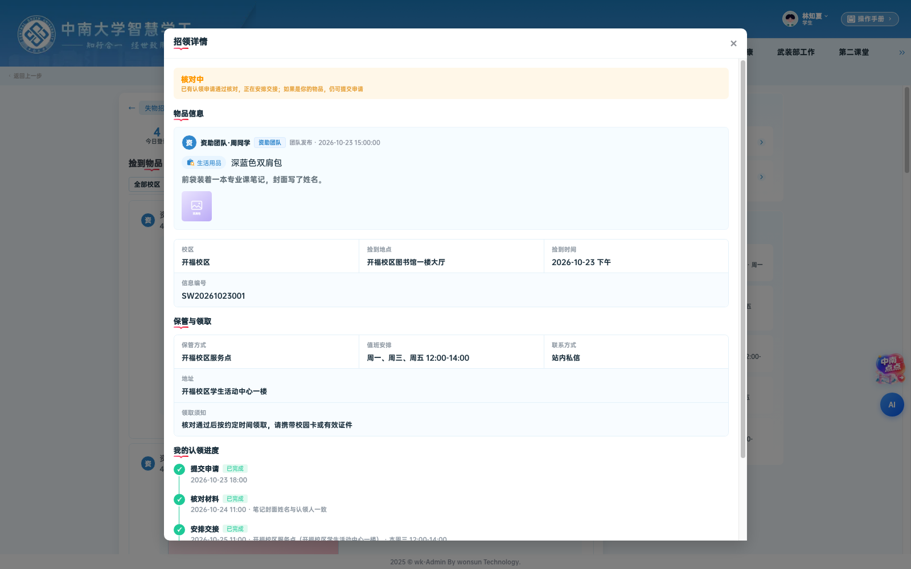

图6 PC 招领详情。物品处于「核对中」。认领进度依次为提交申请、核对材料、安排交接、完成归还。这个弹窗比普通详情更宽。

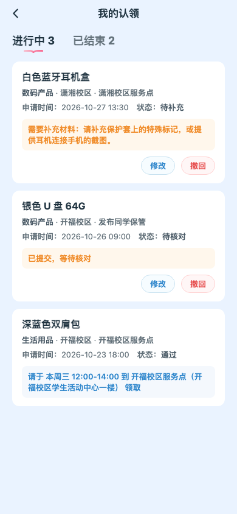

图7 林知夏的「我的认领」。待补充、待核对有「修改」和「撤回」。已经通过并安排了领取时间的「深蓝色双肩包」没有这两个按钮。

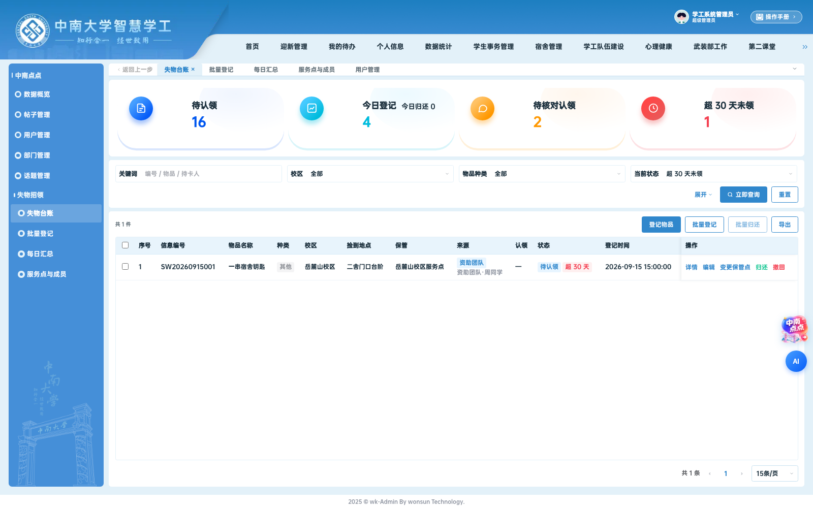

图8 管理端按「超 30 天未领」筛选。这串宿舍钥匙仍是「待认领」，旁边多了「超 30 天」。

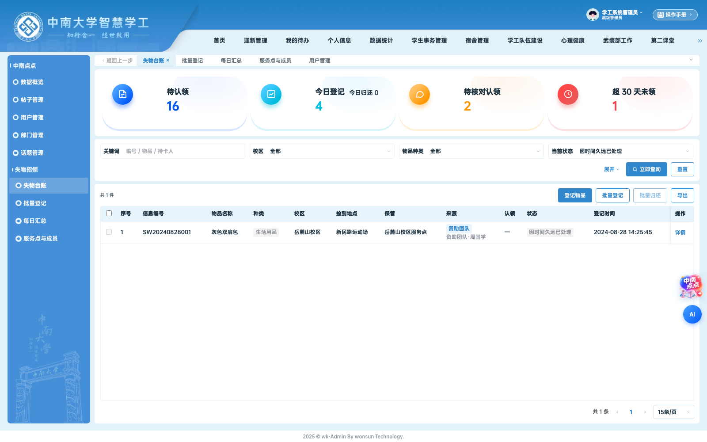

图9 登记超过两年且无人认领的物品，状态显示「因时间久远已处理」。这件灰色双肩包登记于 2024-08-28。

### 3.3 发布：仍在原来的发布页里填写

学生发布拾物或寻物，不另开一套发布站点。

移动端从首页蓝圆「发布心声」，或底栏「发布」，进入原来的「发布新帖」。类型里点「失物招领」，下面就换成失物表单，可选「我捡到东西」或「我丢了东西」。PC 从原来的「发布心声」进入，类型下拉里选择「失物招领」，表单同样留在这一页。PC 底部仍是原来的「预览」「发布」。

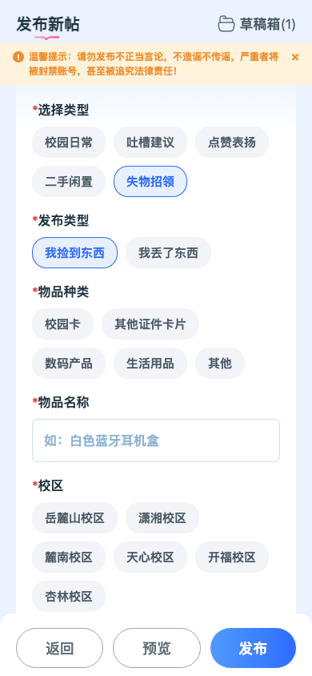

图10 移动端原来的发布页。选中「失物招领」后就地填写，校区为六个。

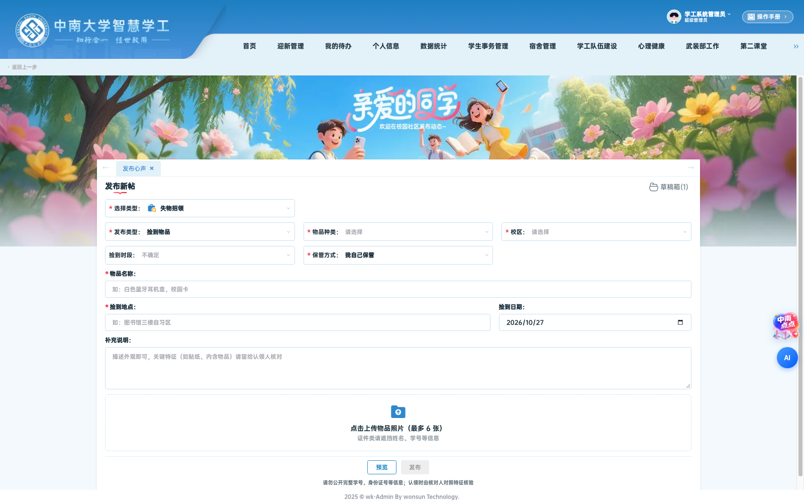

图11 PC 原来的发布页。类型为「失物招领」，按钮仍是原来的发布按钮。

下面两种情况仍进入单独的失物发布页：编辑一条已经发出的失物；团队成员以资助团队身份登记交到服务点的物品。移动端失物列表上的蓝圆「发布招领」，以及 PC 列表上的「发布招领」，也进入这个失物发布页。

发布时至少要选物品种类、填写名称、选择校区、填写地点。招领若选择交到服务点，还要选择服务点。种类有校园卡、其他证件卡片、数码产品、生活用品、其他。校园卡对外只显示姓和末字，例如「王*墨」；完整姓名和学号只给保管人和负责的团队成员看。

图片数量按现在的原型：移动端失物表单最多 3 张；PC 发布页最多 6 张。线索和认领材料两端都是最多 3 张。正式开发时建议统一成一个上限。

### 3.4 资助团队标识

物品上的「资助团队」来自登记方式：用团队身份登记的，显示这个标签，同时用来源「团队发布」。同学自己发的，来源是「同学发布」，没有资助团队标签。标签不替换发布者昵称，昵称旁边仍能看到是谁登记的。

用户管理里可以给账号做「官方认证」。认证时可以单选科室，也可以勾选资助团队，两者可以同时选。科室名单与部门管理一致：学工部、后勤、食堂、图书馆、保卫处，另有「无」。选「无」表示不认证科室。再次点击已选科室可以取消。科室和资助团队都空着时不能保存。

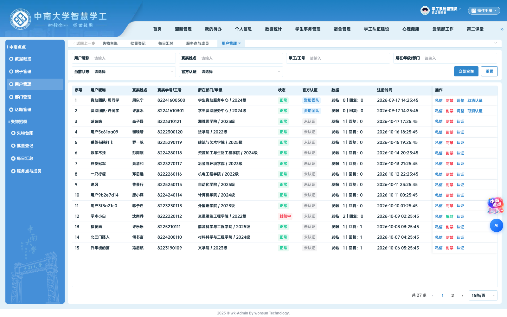

图12 用户管理。周以宁、许嘉禾的官方认证列显示「资助团队」，操作是「调整」「取消认证」。

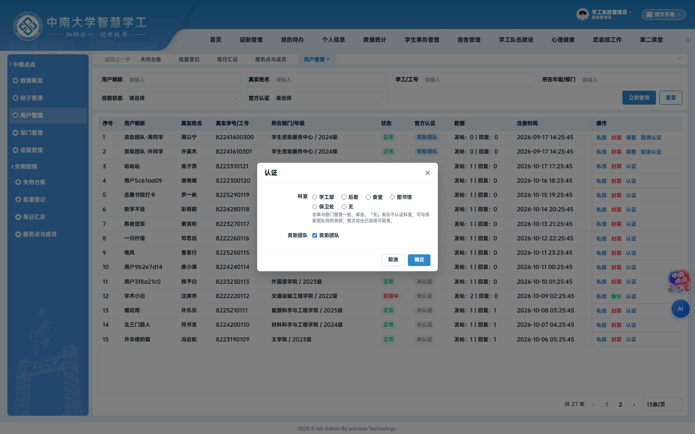

图13 认证弹窗。科室单选，资助团队单独勾选，可以同时成立。

这一处在原型里只留在用户管理当前页，用来给老师看认证怎么选。它不会把人写进资助团队名单，也不会改已经发出的物品标签。真正决定台账范围的，是「服务点与成员」里的角色和服务点。正式系统若要「认证即入团队」，需要单独做写入成员名单的规则，原型还没有这一步。

### 3.5 登记、核对、管理员

角色有三个，写在「服务点与成员」的角色说明里。

| 角色 | 主要工作 | 查看和处理范围 |
| --- | --- | --- |
| 登记成员 | 登记、编辑所负责服务点的物品，生成每日汇总 | 负责服务点的物品信息 |
| 核对成员 | 处理认领，安排交接，确认归还 | 所负责服务点里、交到服务点的认领材料 |
| 管理员 | 配置服务点、成员和异常处理 | 按职责看相关记录，不限某一个服务点 |

一个人可以同时是登记和核对，周以宁就是这样。许嘉禾只有登记。超级管理员在失物招领里同时具备这三种能力，并且还能进原来的帖子管理和用户管理。

团队成员进入管理端后，侧栏只有一组「失物招领」，里面是：失物台账、批量登记、每日汇总、服务点与成员。帖子管理、用户管理等菜单不出现。移动端「我的」里多一项「招领工作台」。没有核对权限的人，工作台里不出现待核对、待交接和批量归还。

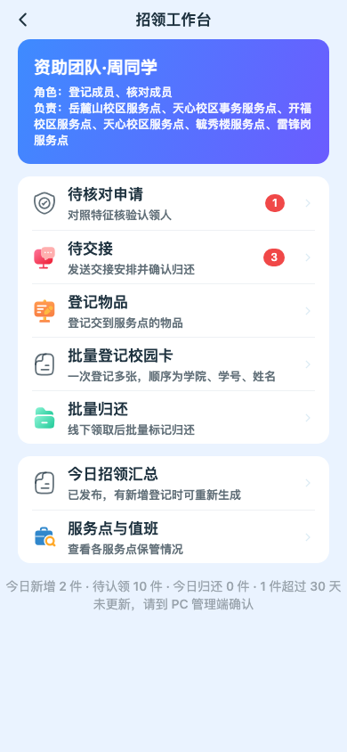

图14 周以宁的移动端招领工作台。登记和核对都有。批量登记说明顺序为学院、学号、姓名。底部提醒有 1 件超过 30 天未更新。

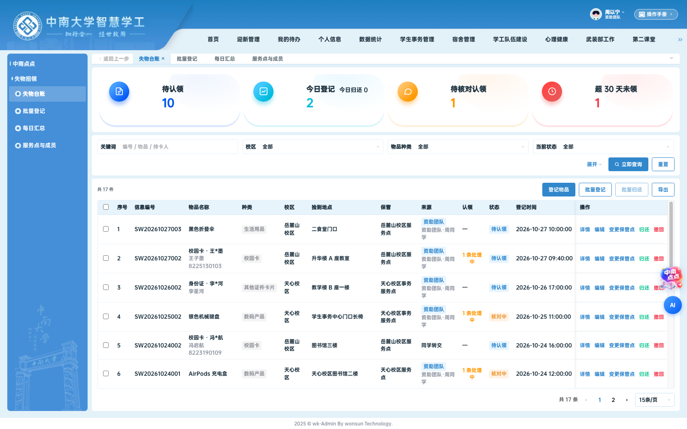

图15 周以宁的管理端。侧栏只有失物招领四个菜单。待认领 10 件，是他所负责服务点里的数量，少于超级管理员看到的全部待认领。

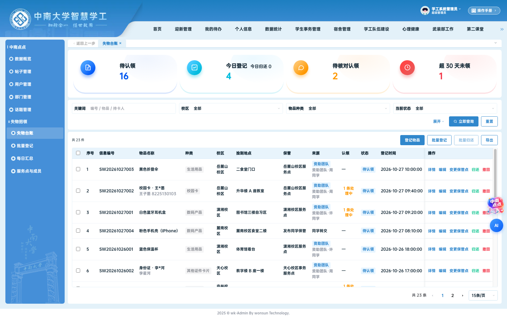

图16 超级管理员的失物台账。原有菜单都在，失物招领单独成组。来源列对团队登记显示「资助团队」，同学交来的显示「同学转交」。

服务点当前有 7 个：岳麓山校区服务点、潇湘校区服务点、天心校区事务服务点、开福校区服务点、天心校区服务点、毓秀楼服务点、雷锋岗服务点。后两个的地址和值班在演示数据里标成待确认，由负责的人补。潇湘校区服务点带一条临时调整：「本周五下午值班暂停，周六 10:00 恢复」，前台服务点信息会显示这句话。

成员表除周以宁、许嘉禾外，还有一行陈语桐，角色显示为管理员，用来讲角色说明。点「配置」只改这一页表格里的角色和可见范围，刷新或重新进入后回到初始示意，不改变谁能登记、谁能核对。页底有这段说明。服务点的新增、编辑、删除，以及地址和值班的修正，会写进演示数据。

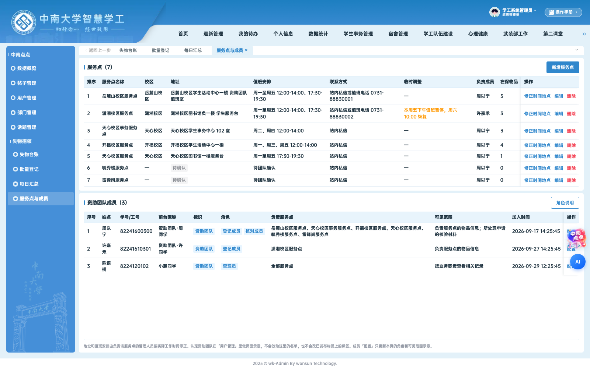

图17 服务点与成员。可修正时间地点。成员表第三行是管理员示意。页底写明认证和配置都不回写真实权限。

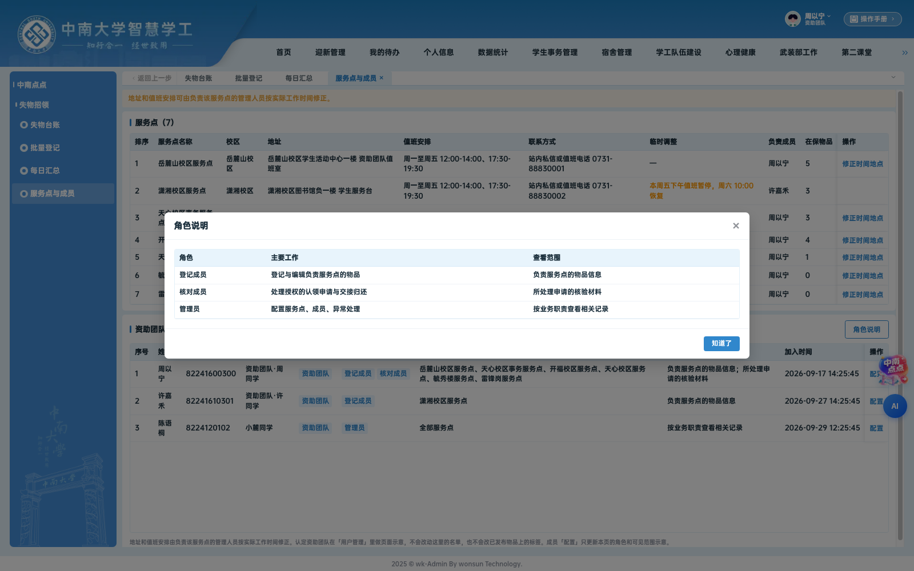

图18 角色说明弹窗。登记管物品，核对管认领和归还，管理员管配置。

### 3.6 寻物线索和通知

任何同学看到一条仍在「寻找中」的寻物，都可以提供线索。线索包含四项：看到的地点、看到的时间、补充说明、图片。地点、时间、说明至少填一项，图片最多 3 张。不能给自己的寻物提供线索。

线索正文只有这条寻物的发布者能看，包括地点、时间和说明。其他人，包括团队成员和超级管理员，看到的是：「线索内容仅寻物发布者可见。」寻找中的寻物，其他人仍可以继续提交新线索。

已经找回、已经撤回的寻物不能再提交。发布者仍可以查看找回之前收到的线索。

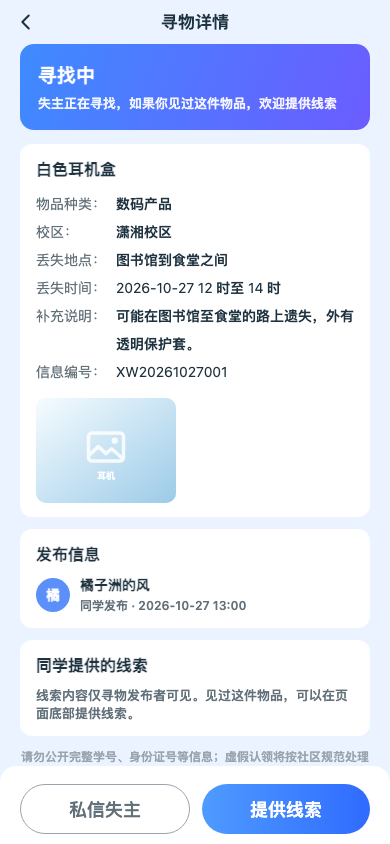

图19 陈语桐查看林知夏的寻物。线索区只有提示句，底部可以「提供线索」。

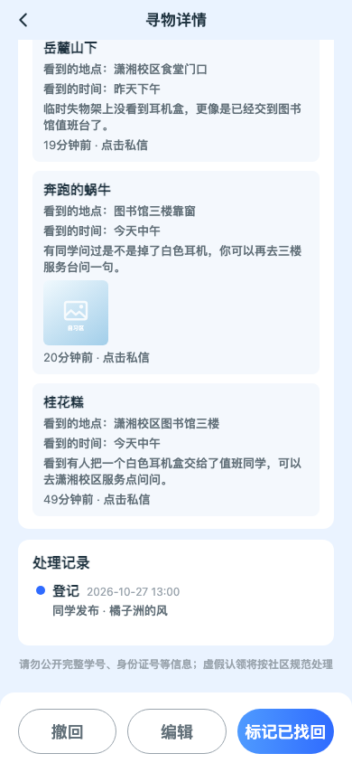

图20 林知夏本人看到三条线索的地点、时间、说明和图片，并可私信提供线索的同学。

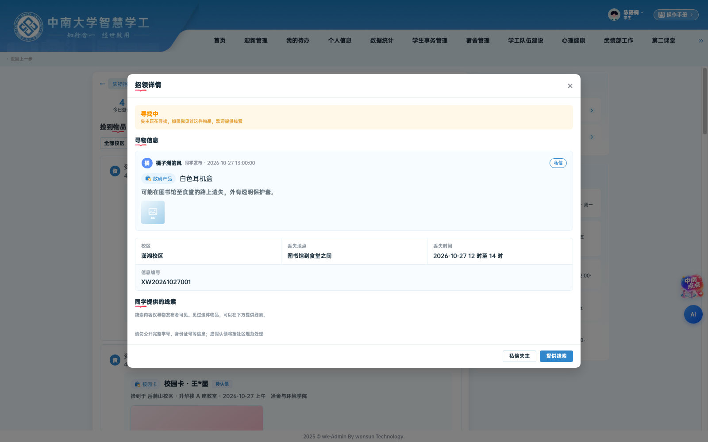

图21 PC 上同一条寻物。登录人是陈语桐，弹窗里同样只有提示，并保留「提供线索」。

通知分两处，介绍时可以一起讲：

- 移动端「消息」里有「失物」一页，用来看认领进度、核对结果、新申请和「有人提供了线索」。
- 站内私信在移动端「我的私信」和 PC「我的私信」。提供线索时，私信正文会带上地点、时间和说明。安排交接时，私信会写上领取地点、时间和联系方式。

PC 前台没有单独的「失物」消息页。核对通过、要求补充、未通过、归还和撤回，主要出现在移动端「消息 → 失物」。安排交接的演示数据里，移动端消息和 PC 私信都能看到；按当前按钮的操作，新安排的交接写入站内私信。

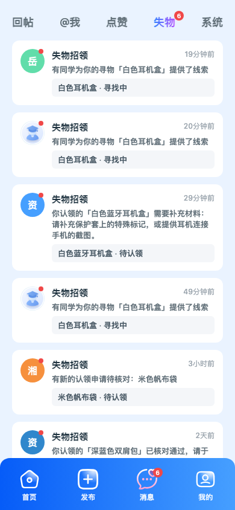

图22 林知夏的「消息 → 失物」。能看到线索提醒、待补充和核对通过。

### 3.7 招领站、当天汇总和筛选

PC 失物列表顶部的三个数字是全校口径：今日登记、待认领、寻找中。点当日汇总，打开「资助团队招领站」。汇总要先由有登记权限的人生成，再人工确认发布，才会出现在前台。汇总包含当天的团队登记和学生自主登记，每一件标明发布端是「团队」还是「学生」。

移动端列表上方也有「今日招领汇总」和「资助团队招领站」，点进去看服务点和当日物品。

筛选在 PC 列表顶部，也在移动端页签下面：校区、种类、时间、来源。来源只有「全部来源」「团队发布」「同学发布」。招领可以勾选「含已归还」，寻物可以勾选「含已找回」。默认列表不展示已撤回，也不展示「因时间久远已处理」。

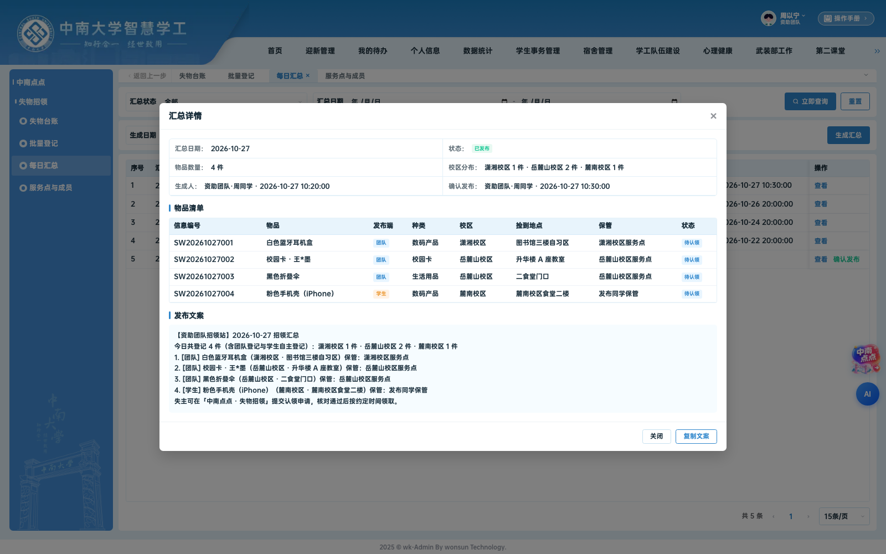

图23 10 月 27 日汇总共 4 件。前三件发布端是团队，粉色手机壳发布端是学生，保管方式是「发布同学保管」。

管理端「每日汇总」列出每一天的数量、校区、种类、待确认或已发布。有登记权限的人可以按日期重新生成。生成后是待确认，确认发布后前台招领站才更新。批量登记成功后，当天汇总会回到待确认，需要再看一眼后发布。

### 3.8 六个校区

校区固定为六个，发布、筛选、批量登记和台账都用这一套名称：

岳麓山校区、潇湘校区、麓南校区、天心校区、开福校区、杏林校区。

批量登记时可以写简称，会自动换成全称：岳麓山、潇湘、麓南、天心、开福、杏林。旧说法也会对上，避免历史表格导不进去：本部或校本部对应岳麓山，新校或新校区对应潇湘，南校或南校区对应麓南，铁道或铁道校区对应天心，湘雅或湘雅校区对应开福，湘雅新校区对应杏林。前台筛选项只出现六个全称。

## 四、按反馈完成的优化

两份反馈是《中南点点程序问题反馈表》和《副本中南点点问题反馈》。下面这些已经能在原型里演示。

### 4.1 首页能第一眼看到失物招领

失物招领从分类里面挪到搜索或轮播下方的蓝色横幅。移动端见图2，PC 见图4。

### 4.2 本周热议改成统一单列

移动端首页的「本周热议排行榜 TOP5」改成自上而下的单列。每一条都有名次、标题、分类和热搜指数，标题最多两行。见图2。PC 右侧热议本来就是一行一条，保持原样，见图4。

### 4.3 私信列表的时间

移动端「我的私信」按距离今天分三档：当天只显示时刻，例如 08:25；同一年只显示月-日，例如 10-05；跨年显示完整日期，例如 2025-09-22。

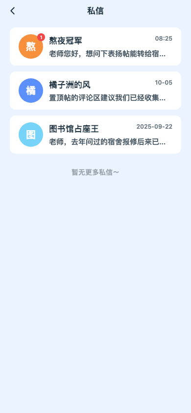

图24 移动端私信列表。当天是时刻，跨年是完整日期。同年的消息显示月-日，不带年份和时刻。

PC 前台的私信列表仍使用「刚刚、几分钟前、几小时前、几天前」。反馈针对的是手机端，PC 这一处没有改。

### 4.4 手机上可以批量登记校园卡

资助团队在移动端工作台可以「批量登记校园卡」，字段顺序与 PC 一致：学院、学号、姓名、校区，空格或逗号隔开，一行一张。没写校区时用默认校区。姓名或校区识别不出来的行不能登记。登记范围限于自己负责的服务点。

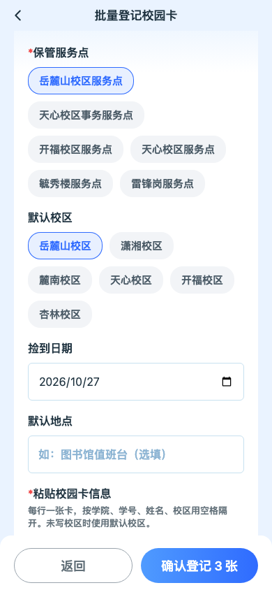

图25 周以宁的手机批量登记。可选服务点不含潇湘校区。说明文字要求按学院、学号、姓名、校区粘贴。

PC 管理端「批量登记」同样按这个顺序识别校园卡，另外还可以逐行登记其他物品。识别提示里写明六个校区简称。

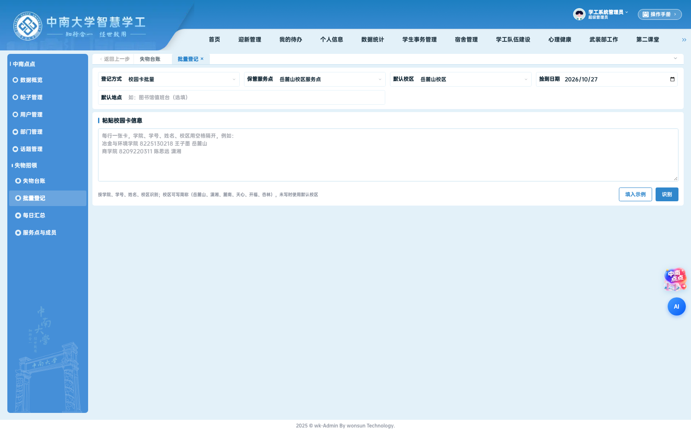

图26 PC 批量登记。示例行就是「学院 学号 姓名 校区」。

### 4.5 待核对、待补充可以修改和撤回

认领人在待核对、待补充时可以修改内容或撤回。撤回后可以重新提交。状态变成通过之后，不论是否已经安排交接，都不能撤回；已完成的也不能撤回。见图7。

### 4.6 管理端字号

管理端正文和表格至少 12 像素，侧栏至少 13 像素，按钮、输入框和标签同样设了下限，行高和单元格间距一并加大。图15、图16可以用来给老师看阅读效果。

### 4.7 每日汇总包含学生登记，并标明来源

汇总不再只有团队登记。当天同学自己发布、且未撤回的招领也会进入这一天。列表和详情里用「团队 / 学生」标出发起方。前台筛选不再使用「只看团队登记」，改为「全部来源 / 团队发布 / 同学发布」。见图5、图23。

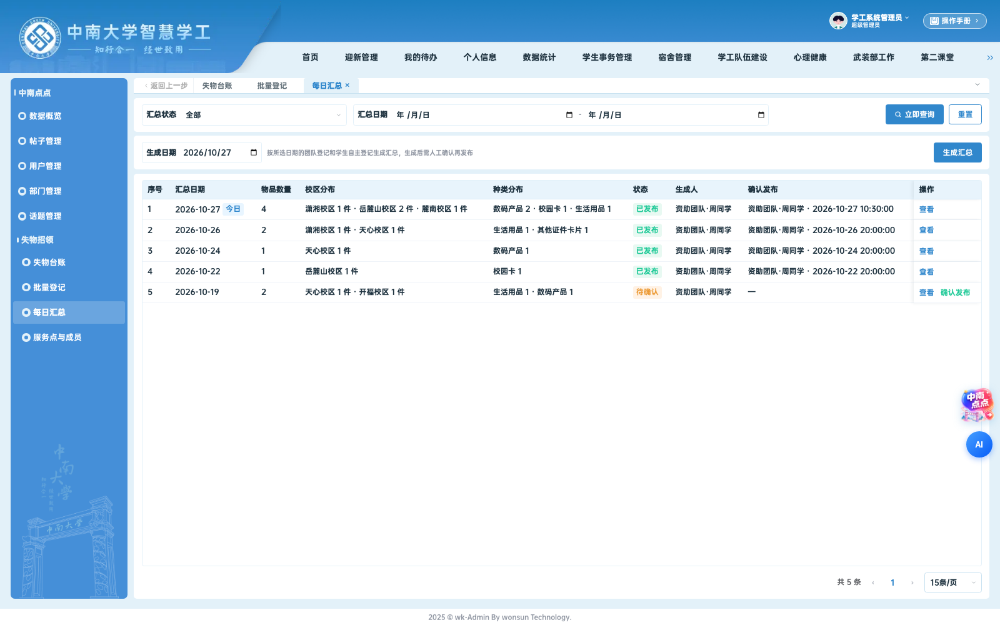

图27 每日汇总列表。生成说明写明包含团队登记和学生自主登记，确认后才发布。

### 4.8 负责服务点的人可以修正地址和值班

有该服务点登记权限的成员，以及团队管理员、超级管理员，可以修改地址、值班安排、联系方式和临时调整。值班安排必填。临时调整留空则前台不展示。修正后，前台「服务点与值班」和物品详情里的领取信息一起更新。新增或删除整个服务点仍只有管理员可以做。

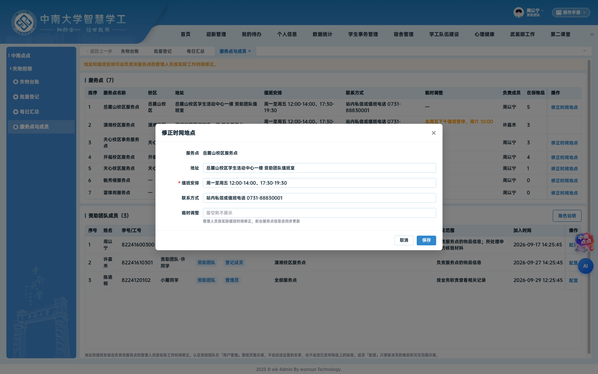

图28 修正时间地点。可改地址、值班安排、联系方式和临时调整。

### 4.9 失物弹窗加宽，举报详情宽度不变

PC 上失物详情、认领申请、汇总详情、角色说明等弹窗宽度为 6.4rem。按现在的页面比例，详情弹窗大约 1000 像素宽，见图6。举报详情仍用原来的详情宽度，大约 2.92rem，没有随失物弹窗加宽。填写举报的小窗仍是大约 560 像素。

### 4.10 反馈里这一版没有单独改的一项

手机底栏「发布」二字的颜色，反馈里提过在常见亮度下不够清楚。底栏仍是蓝底白字，这一版没有单独改字色。介绍时不必把它说成已优化。

## 五、给开发对照的规则

本节只写业务规则、页面、字段和权限，不列代码文件。正式接口可以沿用这些名称和状态。原型里标成「当前页示意」的，不要直接当成已经落库的权限。

### 5.1 和原来的帖子怎么接

失物招领挂在中南点点同一个登录身份下，单独存放，不写入帖子、评论或草稿。

| 原来的能力 | 失物招领怎么用 |
| --- | --- |
| 发布心声 | 类型增加「失物招领」。选中后当前页换成失物表单。编辑旧帖子时不出现这个类型 |
| 帖子列表和热议 | 不展示失物。热议仍只统计心声帖 |
| 站内私信 | 线索和交接安排写入同一套私信，会话列表与普通私信混在一起 |
| 移动端消息 | 增加「失物」分类。点一条消息，有认领则进认领进度，否则进物品详情 |
| 用户与部门 | 科室名单来自现有部门。官方认证的示意不回写部门认证，也不自动加入团队成员 |
| 举报 | 仍只针对心声帖。失物详情不提供举报，举报弹窗宽度保持原样 |
| 信息编号 | 招领为 SW 加日期加三位序号，寻物为 XW 加日期加三位序号，按当天已有条数递增 |

三端同时在线时看的是同一份数据。正式环境应改为服务端保存，并用同一套状态返回给移动端、PC 前台和管理端。

### 5.2 状态

物品状态：

| 状态名 | 用于 | 怎么进入 | 前台默认列表 |
| --- | --- | --- | --- |
| 待认领 | 招领 | 新发布 | 展示 |
| 核对中 | 招领 | 至少一份认领变为通过 | 展示 |
| 已归还 | 招领 | 确认归还 | 需勾选「含已归还」 |
| 寻找中 | 寻物 | 新发布 | 展示 |
| 已找回 | 寻物 | 发布者标记已找回 | 需勾选「含已找回」 |
| 已撤回 | 两类 | 有编辑权限的人填写原因后撤回 | 不展示 |
| 因时间久远已处理 | 招领 | 仍为待认领，且登记超过 730 天。由系统算出，不单独保存 | 不展示 |
| 超 30 天 | 招领上的标记 | 待认领或核对中，且超过 30 天没有新处理。不是独立状态 | 仍按原状态展示，并带标记 |

从「核对中」回到「待认领」的条件：这份通过被改成未通过或要求补充之后，这件物品上已经没有任何「通过」的认领。

认领状态：

| 状态名 | 含义 | 认领人 | 核对人 |
| --- | --- | --- | --- |
| 待核对 | 已提交 | 可修改、可撤回 | 可通过、要求补充、不通过、私信 |
| 待补充 | 已告知要补什么 | 可修改、可撤回；保存后回到待核对 | 可不通过、私信 |
| 通过 | 特征已核对。无交接记录表示还没约时间；有交接记录表示已安排领取 | 不能修改、不能撤回 | 可安排或改期，可确认归还，可私信 |
| 未通过 | 特征不符或物品已撤回、已给别人 | 不能改 | 无后续操作 |
| 已完成 | 已归还 | 不能撤回 | 无后续操作 |
| 已撤回 | 认领人在待核对或待补充时撤回 | 可重新提交新申请 | 无后续操作 |

### 5.3 权限

下面的「负责的点」指该成员被分配的服务点。团队管理员和超级管理员不限服务点。超级管理员额外拥有原有的帖子、用户、部门、话题等菜单。

| 菜单或操作 | 学生 | 仅登记 | 仅核对 | 登记且核对 | 团队管理员 | 超级管理员 |
| --- | --- | --- | --- | --- | --- | --- |
| 管理端失物四个菜单 | 不可进 | 可以，只有这一组 | 可以，只有这一组 | 可以，只有这一组 | 可以，只有这一组 | 可以，并有原有菜单 |
| 数据概览等原有管理页 | 不可进 | 不可进 | 不可进 | 不可进 | 不可进 | 可以 |
| 以团队身份登记、批量登记 | 不可以 | 负责的点 | 不可以 | 负责的点 | 全部点 | 全部点 |
| 编辑、撤回交到服务点的招领，变更保管点 | 只能改自己发的同学物品 | 负责的点 | 不可以 | 负责的点 | 全部点 | 全部点 |
| 生成、确认每日汇总 | 不可以 | 可以 | 不可以 | 可以 | 可以 | 可以 |
| 核对认领、安排交接、确认归还、批量归还 | 只处理自己保管、未交服务点的招领 | 不可以 | 负责的点 | 负责的点 | 全部点 | 全部点 |
| 修正某服务点的地址、值班、联系方式、临时调整 | 不可以 | 负责的点 | 不可以 | 负责的点 | 全部点 | 全部点 |
| 新增、删除服务点 | 不可以 | 不可以 | 不可以 | 不可以 | 可以 | 可以 |
| 发布寻物或同学招领、申请认领、提供线索 | 可以 | 可以 | 可以 | 可以 | 可以 | 可以 |
| 查看线索正文 | 仅自己发布的寻物 | 仅自己发布的寻物 | 仅自己发布的寻物 | 仅自己发布的寻物 | 仅自己发布的寻物 | 仅自己发布的寻物 |

成员表上的「配置」在原型里只改当前页，上表的生效权限以实际登录后的菜单和按钮为准。许嘉禾登录后不能看到核对按钮，台账里没有岳麓山等其他服务点的物品。

当前原型还有一处宽于上表的情况：寻物没有保管服务点。有登记权限的成员，现在也能编辑、撤回这种没有服务点的寻物。正式实现建议收紧为只允许发布者编辑和撤回自己的寻物，登记权限只覆盖交到服务点的招领。验收时要单独试一次「许嘉禾打开林知夏的寻物」。

### 5.4 页面清单

演示时从 `index.html` 进入。下表是进入首页之后的页面。

| 端 | 页面 | 谁会用到 | 做什么 |
| --- | --- | --- | --- |
| 移动端 | 首页 | 所有人 | 搜索下的蓝色入口，进入失物列表 |
| 移动端 | 发布新帖 | 所有人 | 选择失物招领后就地填写 |
| 移动端 | 失物列表 | 所有人 | 捡到物品 / 寻物、筛选、当日汇总、招领站 |
| 移动端 | 物品详情 | 所有人 | 认领、线索、联系、撤回、标记找回或已归还 |
| 移动端 | 失物发布页 | 编辑者、团队登记、列表上的发布招领 | 编辑或团队登记 |
| 移动端 | 我的失物、我的认领 | 学生 | 看自己发布的和自己提交的申请 |
| 移动端 | 消息 → 失物 | 所有人 | 进度和提醒 |
| 移动端 | 我的私信 | 所有人 | 线索正文和交接安排，时间按三档显示 |
| 移动端 | 招领工作台 | 团队成员 | 待核对、待交接、登记、批量登记、批量归还、汇总 |
| 移动端 | 批量登记校园卡 | 有登记权限的成员 | 按学院、学号、姓名、校区粘贴 |
| 移动端 | 认领核对、批量归还 | 有核对权限的成员 | 处理申请，线下领走后批量标记归还 |
| PC 前台 | 首页、发布新帖、失物列表 | 所有人 | 与移动端同一套数据。详情、认领、线索、我的失物、汇总、修正值班用弹窗或侧栏，不另开站点 |
| PC 管理端 | 失物台账 | 团队成员、超级管理员 | 筛选、登记、批量归还、导出、变更保管点 |
| PC 管理端 | 批量登记 | 有登记权限的人 | 校园卡粘贴，或其他物品逐行登记 |
| PC 管理端 | 每日汇总 | 团队成员可看；登记权限可生成和发布 | 按日汇总，人工确认 |
| PC 管理端 | 服务点与成员 | 团队成员可看 | 修正值班；管理员可增删服务点；角色配置为当前页示意 |
| PC 管理端 | 用户管理 → 认证 | 超级管理员 | 科室与资助团队同时选择，当前页示意 |

移动端路径前缀是 `/ywViews/bbs`。例如首页是 `/ywViews/bbs/home/index`，失物列表是 `/ywViews/bbs/lost/index`。PC 前台列表是 `/bbs/lost/index`，管理端台账是 `/bbs/admin/lost/items`。

### 5.5 字段和校验

发布和编辑：

| 字段 | 必填 | 规则 |
| --- | --- | --- |
| 发布类型 | 是 | 招领或寻物。团队登记固定为招领 |
| 物品种类 | 是 | 校园卡、其他证件卡片、数码产品、生活用品、其他 |
| 物品名称 | 是 | 最长 30 字。校园卡对外打码 |
| 校区 | 是 | 六个校区之一 |
| 地点 | 是 | 招领写捡到地点，寻物写可能丢失的地点，最长 40 字 |
| 日期、时段 | 否 | 日期不能晚于今天。时段为上午、中午、下午、晚上 |
| 保管方式 | 招领必填 | 同学可选自己保管或交到服务点。团队登记固定交到服务点，并选择自己负责的点 |
| 补充说明 | 否 | 最长 300 字。对外只写外观，关键特征留给认领人核对 |
| 图片 | 否 | 移动端最多 3 张，PC 发布页最多 6 张。证件需遮挡号码 |
| 持卡人姓名、学号、学院 | 批量校园卡使用 | 只对保管人和负责团队可见 |

认领：

| 字段 | 必填 | 规则 |
| --- | --- | --- |
| 归属特征 | 是 | 最长 300 字。只有失主知道的标记、划痕、内含物品 |
| 丢失时间地点 | 是 | 最长 60 字 |
| 证明材料 | 否 | 最多 3 张，仅核对人可见 |
| 补充要求 | 要求补充时必填 | 会通知认领人 |
| 未通过原因 | 不通过时必填 | 会通知认领人 |
| 交接地点、时间 | 安排交接时必填 | 联系方式选填。默认带出服务点地址、值班和联系方式 |
| 撤回原因 | 撤回物品时必填 | 认领人撤回申请不用填写原因 |

线索：

| 字段 | 必填 | 规则 |
| --- | --- | --- |
| 地点 | 三项至少一项 | 在哪里见过 |
| 时间 | 三项至少一项 | 什么时候见过 |
| 说明 | 三项至少一项 | 最长 300 字 |
| 图片 | 否 | 最多 3 张 |

批量登记校园卡：一行一张，用空格、逗号、顿号或分号分开。学号按连续 6 位以上数字识别，学院按「学院、系、研究院、书院」结尾识别，校区按六个全称或简称识别，姓名按 2 至 5 个汉字识别。顺序建议写成学院、学号、姓名、校区，识别时不强制这个顺序。姓名或校区缺失的行标为需修改，不进入登记。学号、学院可以空着仍登记。必须先选保管服务点。成功后自动重算当天汇总，状态变为待确认。

其他物品的批量行要有名称；空名称的行忽略。

### 5.6 通知落在哪里

| 发生的事 | 移动端消息 → 失物 | 站内私信 |
| --- | --- | --- |
| 有新的认领待核对 | 发给核对人：自己保管的发给发布者；交到服务点的发给该点的核对成员、管理员和负责成员 | 不发 |
| 要求补充、核对未通过、核对通过 | 发给认领人 | 不发 |
| 安排交接 | 演示数据里能看到一条消息。按按钮操作，新的安排不另外写消息 | 发给认领人，正文含地点、时间、联系方式 |
| 确认归还 | 发给这份认领的人；其他未结束申请的人收到「已归还给其他认领人」 | 不发 |
| 物品被撤回 | 发给尚未结束的认领人 | 不发 |
| 有人提供线索 | 发给寻物发布者，只提示「有线索」 | 发给寻物发布者，正文含地点、时间和说明 |

正式系统建议把「安排交接」也写入失物消息，与演示数据一致，避免只使用 PC 的同学漏看领取时间。私信仍然保留，因为里面有完整的地点和时间。

## 六、演示数据与原型边界

数据版本是 6。入口页、移动端原型面板、PC 右上角用户菜单都有「重置演示数据」。重置会清掉当场改过的内容，恢复初始物品、认领、线索和汇总。刷新后如果校区还是旧名称，先重置再介绍。

初始数据里便于对照的例子：

- 林知夏发布了寻物「白色耳机盒」，已有三条线索；她还有待补充、待核对、已安排交接、未通过、已完成等不同认领。
- 陈语桐可以打开这条寻物并提供线索。
- 周以宁负责除潇湘以外的服务点，台账里的待认领少于全校总数。
- 许嘉禾只登记潇湘校区服务点，不能核对。
- 当天汇总里既有团队登记的耳机盒、校园卡、雨伞，也有同学发布的粉色手机壳。
- 「一串宿舍钥匙」带「超 30 天」。「灰色双肩包」显示「因时间久远已处理」。
- 潇湘校区服务点有一条临时调整，用来演示前台怎么显示值班变化。

下面这些写在本文里，是为了避免把原型示意当成已经接上的正式能力：

- 官方认证只留在用户管理当前页，不加入团队名单，也不改物品标签。
- 成员「配置」只改当前页的角色和可见范围。表里的「陈语桐 · 管理员」是讲解用的一行，登录后仍是学生。
- 服务点的新增、删除和值班修正会保存在这次浏览器演示里，重置后恢复。
- 寻物没有服务点时，登记成员目前也能编辑。正式系统建议只允许发布者修改自己的寻物。
- 新的「安排交接」写入私信。移动端消息里那条交接提醒来自初始演示数据。
- 寻物已经找回后，不能再提交线索，发布者仍可看旧线索。其他人打开已结束的寻物时，提示句仍可能写着「可以在页面底部提供线索」，但底部没有提交按钮，提交也会被拒绝。正式文案应改成不能再提供。
- 物品图片移动端最多 3 张、PC 发布页最多 6 张。正式开发需要定一个统一上限。
- 入口页给团队准备的「PC 管理端 · 首页」会因为没有数据概览权限而回到前台。正式系统可以让团队登录后直接进入失物台账。PC 顶栏「中南点点管理」已经会进入台账。
- 手机底栏「发布」的字色未单独调整。PC 私信列表的时间仍是相对时间。

介绍时按第二、三、四章走即可。开发评审时以第五章的表为准，并以第六章核对哪些只是当前页示意。
